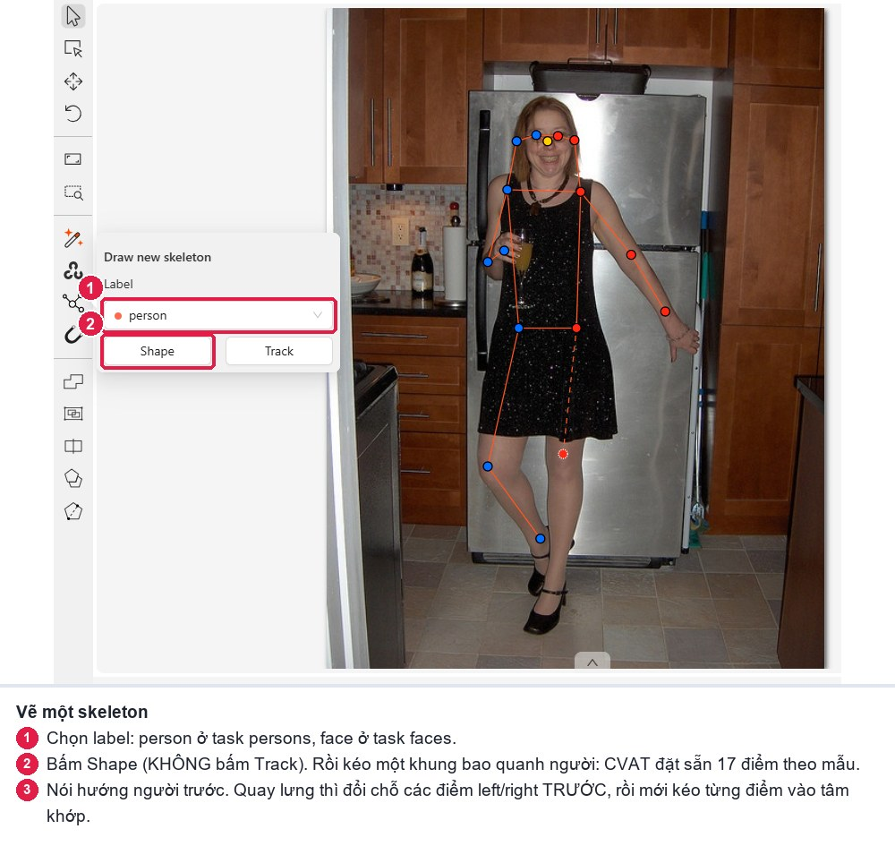
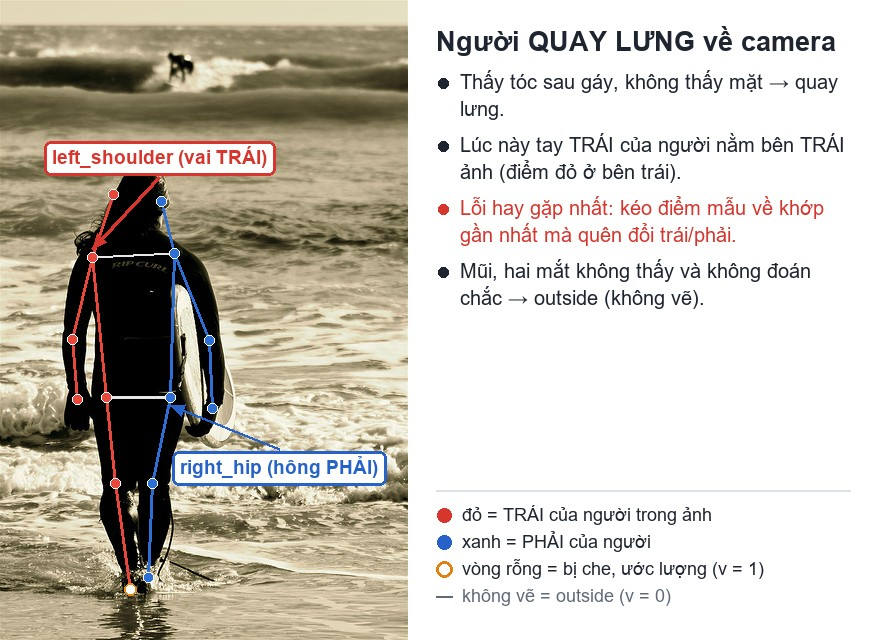
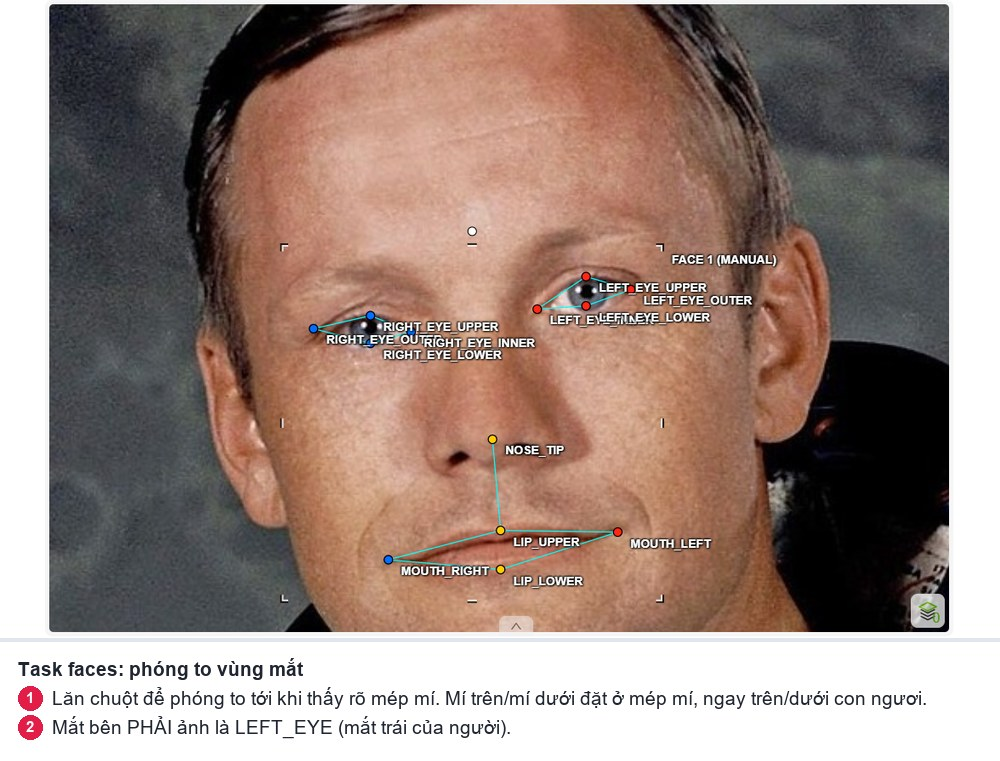
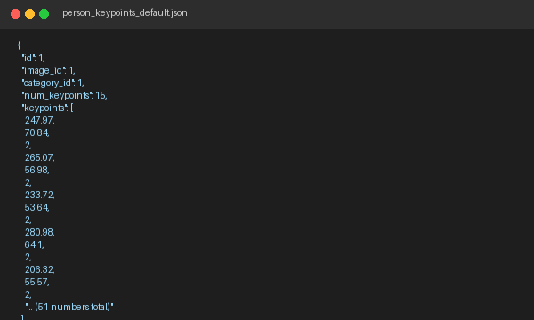

# Báo cáo cá nhân — BuiVanThinh-2A202604040

Đổi tên file theo quy tắc `MSSV_HoTen.md`. Ví dụ: `20241234_NguyenVanAn.md`.

Dữ liệu: 12 ảnh người COCO val2017 (Lin et al., 2014) và 8 ảnh chân dung Wikimedia Commons, chỉ dùng trong lớp.

## 0. Thông tin học viên

- Họ tên: Bùi Văn Thịnh
- MSSV: 2A202604040
- Email: buivanthinhtxt@gmail.com
- Link repository: https://github.com/buivanthinhtxt-del/K5-L2B-DAY04-BUI-VAN-THINH-2A202604040-KeypointPose-Student
- Phiên bản CVAT (Help → About): 2.81.1
- Máy: hệ điều hành Windows 11 · RAM 16 GB · chạy CVAT chế độ lite
- Bộ ảnh (`src/exports/assignment.json` do `lab.py setup` tạo): có
- Giờ bắt đầu: 16:30
- Giờ kết thúc:

## 1. Kiểm tra label (CP0)

| Label | Kiểu | Số điểm | Tên điểm đúng bảng của lab? | Đúng thứ tự? | Số cạnh |
|---|---|---:|---|---|---:|
| `person` | Skeleton | 17 | Có | Có | 19 |
| `face` | Skeleton | 13 | Có | Có | 13 |

Mẫu `person` dựng theo người quay mặt về camera (các điểm `left_*` nằm bên phải khung mẫu)? Có

Cách đổi cờ `occluded` / `outside` cho **một điểm** trên phiên bản CVAT này (một câu):
Rê chuột vào điểm cần đổi (điểm sáng lên), bấm phím `Q` để chuyển thành `occluded` (v = 1, hiển thị vòng rỗng nét đứt), hoặc bấm `O` để chuyển thành `outside` (v = 0, ẩn điểm khỏi ảnh), hoặc nhấp chuột phải vào điểm để chọn cờ tương ứng từ menu popup.

## 2. Số lượng đã gán và thời gian (CP1, CP2)

| Nhóm ảnh | Số ảnh | Số skeleton đã gán | Số người dưới 60 px (không gán) | Số poster / gương / màn hình bỏ qua | Thời gian (phút) |
|---|---:|---:|---:|---:|---:|
| `easy` | 5 | 6 | 0 | 0 | 25 |
| `occluded` | 3 | 4 | 0 | 0 | 20 |
| `back` | 2 | 4 | 0 | 0 | 15 |
| `small` | 1 | 2 | 2 | 0 | 10 |
| `crowd` | 1 | 3 | 0 | 0 | 15 |
| `faces` | 8 | 8 | — | 0 | 25 |

- Số ảnh người đã xong ở mốc phút 105: 10 / 10
- Thời gian thực tế (phút): CP1 85 · CP2 25 · CP3 15
- Ảnh tốn thời gian nhất là ảnh nào, vì sao?
Ảnh `000000413160.jpg` (nhóm `crowd`) tốn nhiều thời gian nhất do có nhiều người đứng gần và chồng lấn nhau. Cần phóng to để phân biệt ranh giới khớp chân và cánh tay của người này không bị nhầm sang người kia, đồng thời rà soát cẩn thận cờ `v = 1` cho các khớp bị che khuất.

## 3. Bảng ca khó (CP1, CP2)

Mỗi điểm bạn phân vân một dòng, nhất là phân vân giữa `v = 1` và `v = 0`, hoặc không chắc hướng người.

| Ảnh | Người / mặt | Điểm | Cờ đã chọn | Phân vân giữa | Lý do chọn |
|---|---|---|---:|---|---|
| `000000030960.jpg` | Người lái xe | `right_ankle` | 0 | `v = 1` và `v = 0` | Cổ chân phải bị thân xe và vật cản che khuất hoàn toàn, không thể nội suy chính xác nên chọn `outside` (`v = 0`). |
| `000000054909.jpg` | Người quay lưng | `nose` | 0 | `v = 1` và `v = 0` | Người quay lưng hoàn toàn về phía camera, đầu hơi cúi, chóp mũi khuất hẳn sau gáy không thể nhìn thấy nên chọn `outside` (`v = 0`). |
| `000000122199.jpg` | Người phụ nữ | `left_elbow` | 1 | `v = 2` và `v = 1` | Khuỷu tay trái bị túi xách che khuất một phần nhưng cánh tay và cẳng tay nhìn rất rõ, hoàn toàn ước lượng chắc chắn vị trí nên đặt `occluded` (`v = 1`). |
| `face_13874.jpg` | Mặt kính râm | `left_eye_upper` | 1 | `v = 2` và `v = 1` | Đối tượng đeo kính râm màu tối, mí mắt trên bị che khuất nhưng ước lượng được chắc chắn theo gọng kính nên đặt `occluded` (`v = 1`). |
| `face_79591.jpg` | Mặt nghiêng | `right_eye_inner` | 1 | `v = 1` và `v = 0` | Mặt quay nghiêng, khóe mắt trong bị sống mũi che lấp một phần nhưng dựa vào góc nghiêng và khóe ngoài vẫn ước lượng chắc vị trí nên chọn `occluded` (`v = 1`). |

## 4. Bảng tự review (CP3)

Đi từ ảnh cuối về ảnh đầu. 5 ảnh người (ít nhất 2 ảnh `back` hoặc `crowd`) và 3 ảnh mặt. Ít nhất 8 dòng, kể cả dòng `ok`. Ghi lỗi trước, sửa sau.

Mã lỗi dùng đúng một trong: `lr_swap`, `vis_flag`, `position`, `missing`, `extra`, `ok`.

| Ảnh | Người / mặt | Điểm | Mã lỗi | Ghi chú | Đã sửa? |
|---|---|---|---|---|---|
| `000000564304.jpg` | Người trượt ván | Toàn thân | `ok` | Hướng nhìn thẳng, các khớp đầu gối và mắt cá chân đặt chính xác, không lỗi. | Có |
| `000000461002.jpg` | Người quay lưng | `left_knee`, `right_knee` | `lr_swap` | Ban đầu bị nhầm giữa đầu gối trái và phải do người quay lưng; đã hoán đổi lại đúng bên người. | Có |
| `000000413160.jpg` | Người đứng sau | `right_wrist` | `vis_flag` | Cổ tay bị người đứng trước che một phần nhưng đang để v=2; đã chuyển sang `occluded` (`v = 1`). | Có |
| `000000438099.jpg` | Người nhỏ phía sau | Toàn thân | `extra` | Người cao dưới 60 px ban đầu bị gán nhầm; đã xóa bỏ skeleton người này theo quy ước của lab. | Có |
| `000000054909.jpg` | Người quay lưng | `nose`, `left_eye` | `vis_flag` | Điểm mắt và mũi không nhìn thấy nhưng để nguyên; đã chuyển sang `outside` (`v = 0`). | Có |
| `face_560526.jpg` | Khuôn mặt tóc che | `left_eye_outer` | `position` | Khóe mắt ngoài bị tóc rủ nhẹ, điểm hơi lệch về phía tóc; đã căn chỉnh lại bám đúng khóe mắt. | Có |
| `face_13874.jpg` | Mặt kính râm | 4 điểm mắt | `vis_flag` | Đã kiểm tra đủ 4 điểm mắt sau kính râm đều mang cờ `occluded` (`v = 1`). | Có |
| `face_122747.jpg` | Mặt thẳng | Toàn bộ 13 điểm | `ok` | Mặt thẳng rõ nét, các điểm mí mắt trên dưới và khóe môi đặt chính xác từng pixel. | Có |

Tổng hợp số lỗi theo mã:

| `lr_swap` | `vis_flag` | `position` | `missing` | `extra` | `ok` |
|---:|---:|---:|---:|---:|---:|
| 1 | 3 | 1 | 0 | 1 | 2 |

Điểm còn phân vân giữa `v = 1` và `v = 0` (ghi cả hai lựa chọn và lý do chọn):
Tại ảnh `000000030960.jpg`, điểm cổ chân phải của người lái xe bị thân xe máy che khuất:
- Nếu chọn `v = 1`: Dựa vào trục cẳng chân từ đầu gối đi xuống có thể áng chừng được khu vực bàn chân đặt lên bàn đạp xe.
- Nếu chọn `v = 0`: Phần thân dưới bị che hoàn toàn bởi kim loại và yếm xe, không thể xác định chính xác vị trí mắt cá chân nằm ở đâu trong khoảng 10-15 px.
- Lựa chọn cuối cùng: Chọn `v = 0` (`outside`) theo đúng nguyên tắc "không đoán bừa" của guideline, tránh làm mô hình học theo tọa độ đoán thiếu căn cứ.

## 5. Kiểm file xuất và kết quả tự kiểm (CP4)

Tự kiểm tay trong file JSON:

| File | Người / mặt kiểm (ảnh, thứ tự) | Số phần tử `keypoints` | Điểm `outside` ra `v = 0`, `occluded` ra `v = 1`? | `num_keypoints` khớp? |
|---|---|---:|---|---|
| `BuiVanThinh_persons.zip` | 000000164659.jpg, người #1 | 51 | Đúng | Đúng (15 điểm v > 0) |
| `BuiVanThinh_persons.zip` | 000000054909.jpg, người #1 | 51 | Đúng | Đúng (13 điểm v > 0) |
| `BuiVanThinh_faces.zip` | face_13874.jpg, mặt #1 | 39 | Đúng | Đúng (13 điểm v > 0, 8 điểm v = 1) |

Sau khi xuất, CVAT ghi `occluded` thành `v = 1` và `outside` thành `v = 0`. Tọa độ của điểm `outside` trong file là `0, 0` hay tọa độ cũ? Tọa độ cũ (CVAT 2.x giữ nguyên tọa độ cũ, đây là đặc tính bình thường của CVAT và chuẩn COCO bỏ qua điểm có v = 0).

Hai job đã chuyển sang completed trên CVAT? Có

Dán phần **TÓM TẮT** in ra từ `src/check_submission.py`:

```text
- File person: BuiVanThinh_persons.zip
  Số ảnh: 12 · số skeleton `person`: 19 · mỗi annotation 51 số
  Skeleton theo ảnh: 000000030960=2, 000000054909=2, 000000122199=2, 000000164659=1, 000000196283=1, 000000201702=1, 000000220045=2, 000000413160=3, 000000438099=1, 000000461002=2, 000000493741=1, 000000564304=1
  Cờ v: v=2 228 (71%) · v=1 38 (12%) · v=0 57 (18%)
  num_keypoints trung bình: 14.0
- File face: BuiVanThinh_faces.zip
  Số ảnh: 8 · số skeleton `face`: 8 · mỗi annotation 39 số
  Skeleton theo ảnh: face_122747=1, face_13874=1, face_232598=1, face_380754=1, face_449454=1, face_560526=1, face_79591=1, face_85624=1
  Cờ v: v=2 88 (85%) · v=1 16 (15%) · v=0 0 (0%)
  num_keypoints trung bình: 13.0
- Ghi chú: 57 điểm v = 0 vẫn mang tọa độ cũ (CVAT 2.x xuất như vậy; chuẩn COCO ghi 0, 0). Không phải lỗi: điểm v = 0 bị bỏ qua khi huấn luyện và khi chấm.
- Số [LỖI]: 0 · số [CẢNH BÁO]: 3
Kết quả: ĐẠT (đọc lại từng cảnh báo ở trên)
```

Các `[CẢNH BÁO]` còn giữ nguyên và lý do:
1. `000000122199.jpg #2`, `000000164659.jpg #1`, `000000461002.jpg #2`: Cảnh báo cặp knee / ankle nằm ngược phía. Lý do giữ nguyên: Đây là tư thế thực tế của người trong ảnh đang bước đi bắt chéo chân hoặc tư thế khi trượt ván / vận động, các điểm đã được kiểm tra bằng mắt đúng theo giải phẫu cơ thể của người trong ảnh chứ không phải lỗi đổi nhầm trái/phải (`lr_swap`).

## 6. Ảnh chụp màn hình

1. Label `person` trong label constructor (đủ 17 điểm có tên):

   

2. Một người quay lưng đã gán, cờ đã đặt:

   

3. Một khuôn mặt đã gán 13 điểm, phóng to vùng mắt:

   

4. Một đoạn JSON xuất của một người:

   

Nguồn ảnh: COCO val2017 / Wikimedia Commons.

## 7. Tự đánh giá

1. Lỗi bạn mắc nhiều nhất hôm nay, và cách bạn sẽ tránh ở dự án thật:
Lỗi dễ mắc nhất là xác định nhầm trái/phải (`lr_swap`) ở các tư thế người quay lưng hoặc nhìn nghiêng. Để tránh lỗi này ở dự án thực tế, quy trình chuẩn là luôn đứng vào góc nhìn của người trong ảnh để tự hỏi "đây là tay/chân bên nào của họ", đồng thời quan sát các đường nối skeleton trên giao diện (nếu thấy chân bắt chéo bất thường thì cần lập tức kiểm tra lại cặp điểm đó).

2. Một quy tắc bạn đề xuất thêm vào guideline (kèm ảnh ví dụ nếu có):
Đề xuất bổ sung quy tắc cụ thể cho người ngồi xổm hoặc co gập chân: Khi đùi và bắp chân ép sát vào nhau, khớp hông và đầu gối rất khó xác định chính xác tâm quay. Guideline nên quy định rõ vị trí nội suy chuẩn dựa trên đường cong cơ thể ngoài cùng và cạp quần để đảm bảo độ nhất quán giữa các annotator.

3. Nhãn của bạn đi vào model ở đâu? Chọn một lỗi bạn đã sửa và nói nó sẽ làm model học sai thế nào (heatmap, trọng số trong loss, hay bước lật ảnh):
Trong các mô hình pose estimation (như HRNet, YOLO-Pose), tọa độ keypoint được biểu diễn bằng heatmap Gauss. Khi huấn luyện, kỹ thuật Data Augmentation thực hiện phép lật ngang ảnh (horizontal flip) và tự động hoán đổi các cặp điểm trái/phải (`left_shoulder` ↔ `right_shoulder`, `left_knee` ↔ `right_knee`...). Nếu annotator mắc lỗi `lr_swap`, bước lật ảnh này sẽ làm sai lệch hoàn toàn nhãn đối xứng, khiến mô hình bị phạt loss oan uổng và không thể học hội tụ chính xác giữa bên trái và bên phải. Đồng thời các điểm bị che nếu không đặt cờ `v = 1` / `v = 0` sẽ bị tính phạt ngang với các điểm nhìn thấy rõ, ép mô hình đoán mò ở các vùng không nhìn thấy.

## 8. Khó khăn và lỗi kỹ thuật
Giao diện CVAT đôi khi cần tải lại khi nạp nhiều ảnh lớn, đã khắc phục bằng cách chạy chế độ `lab.py lite` để tối ưu tài nguyên RAM của máy. Quá trình xuất dữ liệu và kiểm tra diễn ra trơn tru với script `check_submission.py`.

## 9. Tài liệu tham khảo và công cụ đã dùng
- Tài liệu COCO Keypoints Format 1.0.
